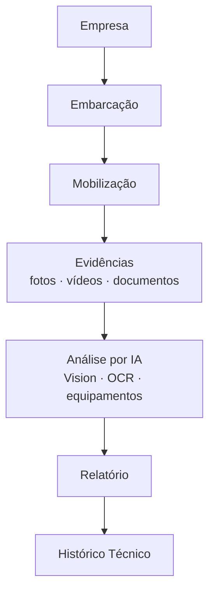

# Arquitetura da Plataforma — Bykonz Marine Platform

**Status:** Definição de arquitetura (v2)
**Objetivo:** Plataforma inteligente de gestão de mobilizações técnicas marítimas da Bykonz.

---

## 1. Visão Geral

A Bykonz Marine Platform é o sistema central de gestão de **mobilizações técnicas marítimas**.
O fluxo principal da plataforma segue uma hierarquia rígida:



Toda a arquitetura é construída **em torno desse fluxo**. A IA é um pilar central: o técnico
envia evidências e a IA analisa, organiza, gera descrições técnicas, sugere pendências e monta
o relatório automaticamente. O técnico apenas **revisa e aprova**.

## 1.1 Stack Tecnológica

| Camada | Tecnologia |
|--------|-----------|
| Backend | Node.js + TypeScript + Express |
| Banco de dados | PostgreSQL + Prisma ORM |
| Frontend | React 19 + Vite + TanStack Router/Query + ShadCN UI |
| I18n | i18next (PT/EN/FR) |
| Armazenamento | MinIO (dev) / Amazon S3 (prod) / Azure Blob (futuro) |
| Filas | BullMQ + Redis (processamento assíncrono) |
| IA | OpenAI (abstraído via `AiProvider`) |
| Notificações | WhatsApp (WAHA), Telegram, e-mail (SMTP) |

---

## 2. Objetivos de Arquitetura

Prioridades que guiam toda decisão:

| Princípio | Descrição |
|-----------|-----------|
| Escalabilidade | Preparado para milhares de mobilizações |
| Organização | Estrutura limpa por domínios |
| Performance | Paginação, cache, lazy loading, filas |
| Segurança | JWT, RBAC, auditoria, versionamento |
| Baixo acoplamento | Módulos independentes, comunicação via serviços |
| Alta reutilização | Componentes e serviços reutilizáveis |
| Modularidade | Domínios isolados com responsabilidade única |
| Preparação para IA | Módulo de IA independente e plugável |
| Preparação p/ integrações | IoT, MQTT, APIs marítimas, mobile |

---

## 3. Princípios Fundamentais

1. **Arquitetura por domínios** — cada módulo de negócio contém páginas, componentes,
   serviços, validações, rotas, tipos, APIs e permissões próprias.
2. **Nenhum módulo depende diretamente de outro** — toda comunicação ocorre através de
   serviços bem definidos.
3. **O banco é a fonte da verdade** — o PDF é apenas uma representação visual; toda
   informação permanece estruturada no banco.
4. **IA como módulo independente** — nenhum código de IA é misturado com regras de aplicação.
   É possível trocar o modelo de IA sem alterar o restante.
5. **Storage único** — nenhum módulo acessa armazenamento diretamente; tudo passa pelo
   Storage Service.
6. **Processamento assíncrono** — tarefas pesadas (upload, OCR, IA, PDF) rodam em background.
7. **Embarcação como entidade principal** — a identidade visual e o fluxo giram em torno da
   embarcação, refletindo o ambiente offshore e naval.

---

## 4. Fluxo de Trabalho com IA

```
Selecionar embarcação
   ↓
Criar mobilização
   ↓
Enviar fotos
   ↓
Enviar vídeos
   ↓
Enviar documentos
   ↓
Adicionar observações rápidas (opcional)
   ↓
IA analisa automaticamente todas as evidências
   ↓
IA identifica equipamentos
   ↓
IA executa OCR
   ↓
IA organiza as evidências
   ↓
IA gera descrições técnicas
   ↓
IA sugere pendências
   ↓
IA monta automaticamente o relatório técnico
   ↓
Técnico revisa e aprova o relatório
```

---

## 5. Visão de Longo Prazo

A arquitetura é desenhada para suportar:

- Assistente técnico com IA
- Pesquisa inteligente em relatórios
- Comparação entre mobilizações
- Histórico completo por embarcação
- Dashboard com indicadores
- Monitoramento em tempo real
- Integração com IoT e MQTT
- Integração com APIs marítimas
- Aplicativo móvel para técnicos
- Funcionamento offline com sincronização posterior
- Multiempresa (multi-tenant)
- Multi-idioma (Português, Inglês, Francês)

---

## 6. Estratégia de Implementação

A nova arquitetura é criada **em paralelo** com o código atual, mantendo o sistema em
produção funcionando. A migração é **incremental**: módulo a módulo.

Ver os demais documentos:
- [`01-domain-model.md`](./01-domain-model.md) — domínios e fluxo
- [`02-backend-layers.md`](./02-backend-layers.md) — camadas do backend
- [`03-database.md`](./03-database.md) — modelo de dados
- [`04-frontend-modules.md`](./04-frontend-modules.md) — frontend modular
- [`05-ai-module.md`](./05-ai-module.md) — módulo de IA
- [`06-storage.md`](./06-storage.md) — storage service
- [`07-queues.md`](./07-queues.md) — processamento assíncrono
- [`08-security.md`](./08-security.md) — segurança
