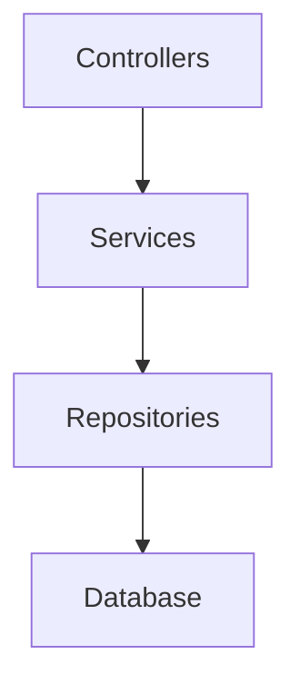
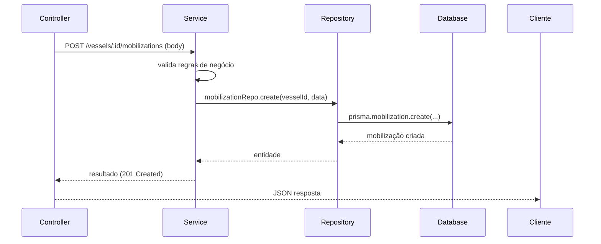

# Backend em Camadas — Bykonz Marine Platform

## 1. Arquitetura em Camadas

O backend segue estritamente a separação em camadas:



## 2. Estrutura por Módulo

Cada módulo de domínio reside em `src/modules/<dominio>/`:

```
src/modules/
  <dominio>/
    controller/       # HTTP handling (validação de entrada, status codes)
    service/          # Regras de negócio
    repository/       # Acesso ao banco (Prisma)
    routes/           # Definição de rotas Express
    types/            # Tipos e interfaces do módulo
    validation/       # Schemas de validação (zod)
    index.ts          # Exportações públicas do módulo
```

## 3. Separação de Responsabilidades

| Camada | Responsabilidade | Proibido |
|--------|------------------|----------|
| Controller | Receber/validar HTTP, orquestrar chamadas de serviço | Regras de negócio, acesso ao banco |
| Service | Regras de negócio, orquestração | Acesso HTTP detalhado, acesso direto ao banco |
| Repository | Acesso ao banco (CRUD), queries | Regras de negócio |
| Database | Prisma / Postgres | — |

## 4. Serviços Transversais (Infraestrutura)

Estes serviços são **compartilhados** entre módulos e têm responsabilidade única:

- **Storage Service** — acesso ao armazenamento (MinIO/S3/Azure). Nenhum módulo acessa storage diretamente.
- **Queue Service** — processamento assíncrono (uploads, OCR, IA, compressão, PDF, notificações).
- **Auth Service** — JWT, Refresh Token, RBAC.
- **Audit Service** — auditoria e logs de acesso.
- **Notification Service** — notificações (WhatsApp, Telegram, e-mail).

## 5. Separação Completa de Aspectos

A aplicação separa completamente:
- Regras de negócio
- Acesso ao banco
- Autenticação
- Autorização
- Uploads
- IA
- Geração de PDF
- Notificações
- Integrações externas

## 6. Exemplo de Fluxo



```
[Controller] /vessels/:id/mobilizations (POST)
   ↓
[Service] MobilizationService.createMobilization(vesselId, input)
   ↓
[Repository] MobilizationRepository.create(vesselId, data)
   ↓
[Database] prisma.mobilization.create(...)
```

## 7. Estrutura de Pastas do Backend

```
src/
  modules/                    # módulos de domínio
    <dominio>/
      controller/
      service/
      repository/
      routes/
      types/
      validation/
      index.ts
  shared/                     # serviços transversais reutilizáveis
    storage/                  # Storage Service (MinIO/S3/Azure)
    queue/                    # Queues (BullMQ/Redis)
    auth/                     # Auth Service (JWT/Refresh/RBAC)
    audit/                    # Auditoria
    notifications/            # Notificações
    logger/                   # Logging
    errors/                   # Classes de erro padronizadas
  config/                     # Configuração (env)
  lib/                        # Clientes infra (prisma, s3, etc.)
  container.ts                # Injeção de dependência
  index.ts                    # Bootstrap
```

## 8. Regras por Camada (Checklist)

| Camada | Faz | Não faz |
|--------|-----|---------|
| Controller | parse/validação de entrada, status codes, binding de sessão | regras de negócio, acesso a banco, IA, storage |
| Service | orquestração, regras de negócio, transações, chamada a outros serviços | SQL direto, detalhes HTTP |
| Repository | queries Prisma, CRUD, soft-delete, paginação | regras de negócio |
| Database | Postgres (schema gerenciado por Prisma migrations) | — |
