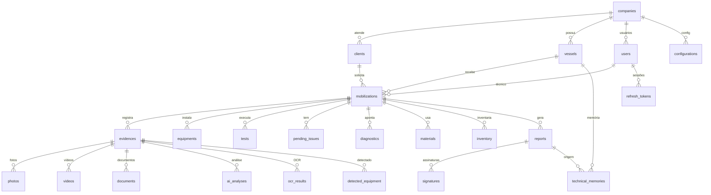

# Modelo de Dados — Bykonz Marine Platform

## 1. Princípios de Modelagem

1. **Entidades independentes** — cada entidade é modelada de forma desacoplada, sem
   duplicação de informação.
2. **Relacionamentos claros** — FKs explícitas e índices para consultas otimizadas.
3. **Banco é a fonte da verdade** — o PDF é apenas representação visual; os dados ficam
   estruturados no banco para consultas, estatísticas e dashboards.
4. **Convenção snake_case** nas tabelas (padrão Postgres), modelos PascalCase no Prisma.
5. **Soft-delete e versionamento** — proteção contra exclusão acidental.
6. **Auditoria** — histórico de alterações por registro.

## 2. Fluxo Principal (Relacionamentos)

> Convenção: `||--o{` = um para muitos. As tabelas são `snake_case` plural no banco.

## 3. Entidades de Domínio

### Núcleo (Fluxo Principal)
- **companies** — empresas (multi-tenant)
- **clients** — clientes
- **vessels** — embarcações (entidade principal)
- **mobilizations** — mobilizações técnicas
- **evidences** — evidências (categoria, observação, descrição IA, ordem)
- **photos / videos / documents** — mídias da evidência
- **equipments** — equipamentos
- **reports** — relatórios técnicos
- **signatures** — assinaturas digitais

### Inteligência Artificial
- **ai_analyses** — análise de IA por evidência (descrição, tags, confiança, anomalias)
- **ocr_results** — resultado de OCR
- **detected_equipment** — equipamentos detectados pela IA
- **technical_memory** — memória técnica por embarcação (embeddings, RAG)

### Complementos da Mobilização
- **tests** — testes executados
- **pending_issues** — pendências
- **diagnostics** — diagnósticos
- **materials** — materiais utilizados
- **inventory** — inventário

### Infraestrutura
- **users** — usuários e perfis
- **refresh_tokens** — tokens de renovação
- **notifications** — notificações
- **configurations** — configurações
- **audit_logs** — auditoria

## 4. Convenções

- Tabelas: `snake_case` plural via `@@map`.
- Modelos Prisma: `PascalCase` singular.
- Índices em todas as FKs e campos de consulta frequente (`@@index`).
- `createdAt`/`updatedAt` em todas as entidades de domínio.
- Soft-delete via coluna `deletedAt` ou flag `active` quando aplicável.
- Versionamento via coluna `version` (incrementada a cada update).

## 5. Relação com o Schema Atual

O novo schema é criado **em paralelo**. Os modelos duplicados atuais
(`VesselEvidence`/`TechnicalEvidence`, `VesselMobilization`/`TechnicalMobilization`)
serão unificados nas novas entidades. A migração é incremental.
