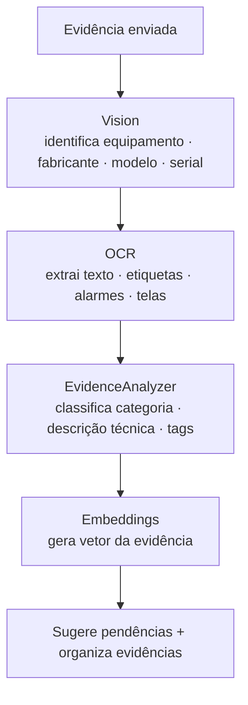

# Módulo de IA — Bykonz Marine Platform

## 1. Independência Total

A IA é um módulo completamente independente. **Nenhum código de IA é misturado com regras
da aplicação.** No futuro, será possível trocar o modelo de IA sem alterar o restante.

## 2. Estrutura do Módulo

```
src/modules/ai/
  vision/           # Análise de imagens (Vision)
  ocr/              # Extração de texto (OCR)
  promptEngine/     # Montagem e gerenciamento de prompts
  embeddings/       # Vetores de embedding
  memory/           # Memória técnica por embarcação
  rag/              # Retrieval-Augmented Generation
  reportGenerator/  # Geração de relatórios
  evidenceAnalyzer/ # Análise de evidências
  types/            # Tipos e contratos
  service/          # Orquestração dos sub-módulos
  index.ts
```

## 3. Abstração do Modelo

Define-se uma **interface** (contrato) que o modelo de IA deve implementar:

```ts
interface AiProvider {
  analyzeImage(input: ImageInput): Promise<VisionResult>;
  extractText(input: ImageInput): Promise<OcrResult>;
  generateReport(input: ReportInput): Promise<ReportResult>;
  createEmbedding(text: string): Promise<number[]>;
  complete(prompt: string): Promise<string>;
}
```

Implementações: `OpenAiProvider`, `AnthropicProvider`, `LocalProvider` (fallback), etc.
A aplicação depende apenas da interface, nunca de um provedor específico.

## 4. Fluxo de Análise de Evidências



## 5. Geração de Relatório

```
Mobilização + evidências analisadas
   ↓
[RAG] consulta memória técnica da embarcação
   ↓
[ReportGenerator] monta relatório (estrutura Bykonz)
   ↓
[Memory] persiste memória da embarcação (embedding)
   ↓
Relatório estruturado no banco (PDF é apenas visualização)
```

## 6. Fallback Local

Quando não há chave de API configurada, um **provedor local determinístico** (keyword-based)
mantém o fluxo funcionando em desenvolvimento/staging. Ver `src/modules/ai/providers/local`.
