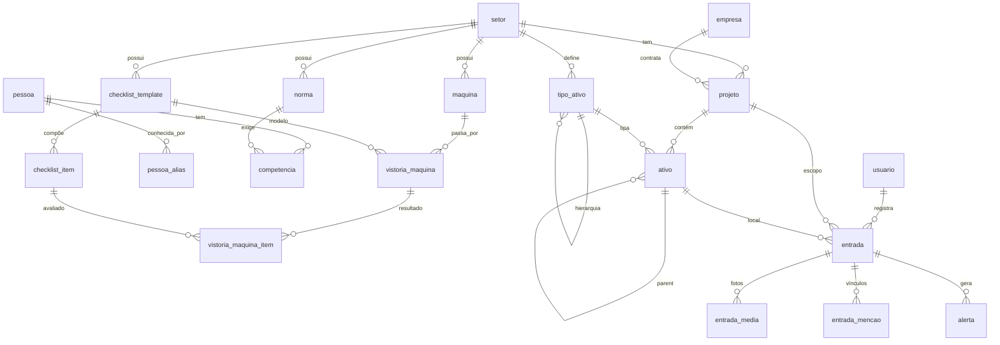

# Arquitetura de Dados — Plataforma de Vistorias (Diário das Obras) · v1

**Tipo de documento:** Proposta de arquitetura de dados para validação (handoff técnico interno — Tanen)
**Status:** Proposta · aguarda aprovação antes da implementação (Prisma/migrations)
**Data:** 23/06/2026
**Base:** evolução do schema atual (`Usuarios`, `Empresa`, `Entrada`, `_EntradaMedia`, `WhatsappConversationState`)

---

## 1. Decisões que guiaram este desenho

| Tema                     | Decisão                                                                          | Implicação no modelo                                                                  |
| ------------------------ | -------------------------------------------------------------------------------- | ------------------------------------------------------------------------------------- |
| Identificação na legenda | **Híbrida:** códigos padronizados primeiro, IA/LLM em seguida                    | Tabela de vínculos com **origem e confiança** (`entrada_mencao`)                      |
| Modelagem multi-setor    | **Núcleo comum + extensões por setor, dirigido por configuração** (recomendação) | `setor` como discriminador + hierarquia de ativos parametrizável + atributos em JSONB |
| Treinamento/competência  | **Matriz pessoa × norma**, avaliada no momento do registro                       | `competencia` + alertas persistidos como _snapshot_                                   |

### Por que "núcleo comum + extensões" (e não tabelas separadas por setor)

Você pediu a melhor prática. Para uma plataforma de **vistorias** que atende civil e naval com o **mesmo fluxo** (foto + legenda → vínculo de norma/pessoa/máquina → alerta → relatório), o padrão recomendado é **um modelo unificado parametrizado por setor**, não tabelas físicas separadas.

- **Tabelas separadas por setor** duplicam regras, queries e telas. Cada novo setor (ex.: futuramente energia, logística) exigiria nova migration e novo código — não escala.
- **Modelo unificado** mantém **uma base de código e um caminho de query**. As diferenças entre setores ficam em **dados de configuração** (tipos de ativo, templates de checklist) e em **atributos flexíveis** (`JSONB`), não em estrutura física. Adicionar um setor passa a ser **cadastro**, não desenvolvimento.
- A variabilidade real entre civil e naval está sobretudo na **hierarquia de locais** (apartamento/laje vs. compartimento/convés) e nas **características** de cada ativo. Ambas são resolvidas por configuração + JSONB, preservando integridade relacional no núcleo.

**Resumo:** núcleo relacional forte e comum; pontas flexíveis por configuração. É o equilíbrio entre rigor e extensibilidade.

---

## 2. Princípios de modelagem

1. **`setor` é o eixo transversal.** Toda entidade de domínio carrega `setor_id`, permitindo isolamento lógico e filtros consistentes.
2. **Ativos como árvore genérica.** Apartamento, laje, embarcação e compartimento são todos nós de uma mesma estrutura hierárquica (`ativo`), tipados por `tipo_ativo` (configurável por setor). É isso que viabiliza o **QR Code da v2** (cada nó pode ter um token).
3. **Proveniência explícita.** Todo vínculo extraído de uma legenda guarda **como** foi obtido (código, IA ou manual) e, quando aplicável, a **confiança** — auditável e essencial para o caminho híbrido.
4. **Alertas como _snapshot_.** Treinamento e vistoria mudam com o tempo; o relatório deve refletir o status **no momento do registro**. Por isso o alerta é **persistido**, não recalculado.
5. **Distinção `usuario` × `pessoa`.** Quem opera o bot (engenheiro/gestor) é `usuario`; quem é citado na legenda e executa o serviço é `pessoa` (mão de obra). São populações diferentes (ver §8).
6. **Convenção `snake_case`** para as tabelas novas (padrão Postgres), com plano de alinhamento do legado (§9).

---

## 3. Modelo conceitual (diagrama ER)



> `entrada_mencao` é **polimórfica** (`entidade_tipo` + `entidade_id`), por isso aponta logicamente para `norma`, `pessoa`, `maquina` ou `ativo` sem FK física única (ver §4.6).

---

## 4. Detalhamento das tabelas

### 4.1 Configuração multi-setor

**`setor`** — eixo transversal.
`id` · `codigo` (CIVIL, NAVAL) · `nome` · `ativo`

**`tipo_ativo`** — define os níveis de hierarquia **por setor** (parametrizável).
`id` · `setor_id` (FK) · `codigo` · `nome` · `nivel` (ordem) · `parent_tipo_id` (FK self, define encadeamento permitido)
_Civil:_ `OBRA → TORRE → PAVIMENTO/LAJE → UNIDADE → LOCAL`.
_Naval:_ `EMBARCACAO → SECAO/CONVES → COMPARTIMENTO`.

**`prefixo_codigo`** — mapeia o prefixo do código padronizado ao tipo de entidade (configurável).
`id` · `setor_id` (FK, opcional) · `prefixo` (PS, MX, MAT…) · `entidade_tipo` (NORMA, MAQUINA, PESSOA, ATIVO)
_Ex.:_ `PS → NORMA`, `MX → MAQUINA`, `MAT → PESSOA`. É o que o parser determinístico usa para classificar `(PS-024)`.

### 4.2 Ativos e projetos

**`empresa`** _(reaproveita a atual)_ — cliente. `id` · `nome`.

**`projeto`** — a obra (civil) ou o programa/embarcação em vistoria (naval). É o **escopo de relatório**.
`id` · `empresa_id` (FK) · `setor_id` (FK) · `codigo` · `nome` · `status` · `atributos` (JSONB)

**`ativo`** — o nó hierárquico genérico (local/estrutura). Unifica apartamento, laje, embarcação, compartimento.
`id` · `projeto_id` (FK) · `setor_id` (FK) · `tipo_ativo_id` (FK) · `parent_ativo_id` (FK self) · `codigo` (ex.: `1403`) · `nome` · `atributos` (JSONB — _civil:_ área, pavimento; _naval:_ IMO, tonelagem, calado) · `qrcode_token` (nullable, **preparado para v2**) · `ativo`

### 4.3 Normas

**`norma`** — catálogo de normas/procedimentos, por setor.
`id` · `setor_id` (FK) · `codigo` (PS-024) · `titulo` · `descricao` · `versao` · `vigente` · `atributos` (JSONB)
_Vínculo automático:_ o código entre parênteses casa com `norma.codigo` no setor do projeto.

### 4.4 Pessoas e competência (treinamento)

**`pessoa`** — mão de obra citada nas legendas.
`id` · `setor_id` (FK) · `empresa_id`/`projeto_id` (vínculo) · `nome` · `matricula` (código padronizado, ex.: MAT-123) · `funcao` · `status` (ATIVO, AFASTADO, DESLIGADO)

**`pessoa_alias`** — apelidos/variações de nome para casamento por texto/IA ("José", "Zé", "J. Silva").
`id` · `pessoa_id` (FK) · `alias`
_Por que existe:_ sem matrícula na legenda, a identificação por nome livre é ambígua; os aliases reduzem falsos negativos e ajudam a IA a desambiguar.

**`competencia`** — matriz **pessoa × norma** (decisão da Q3).
`id` · `pessoa_id` (FK) · `norma_id` (FK) · `status` (TREINADO, PENDENTE, VENCIDO) · `data_treinamento` · `validade_ate` (nullable) · `certificado_url` (nullable)
_Regra do alerta:_ registro que vincula `pessoa` + `norma` sem `competencia` válida (status ≠ TREINADO ou `validade_ate` < data do registro) → **alerta de pessoa não treinada**.

### 4.5 Máquinas e vistorias (checklist)

**`maquina`** — equipamento controlado.
`id` · `setor_id` (FK) · `projeto_id` (FK, nullable) · `codigo` (MX-007) · `nome` · `tipo` · `status` · `atributos` (JSONB)

**`checklist_template`** — modelo de checklist (por setor/tipo de máquina).
`id` · `setor_id` (FK) · `aplicacao` (tipo de máquina) · `nome` · `validade_dias` (janela de validade padrão)

**`checklist_item`** — itens do modelo.
`id` · `template_id` (FK) · `ordem` · `descricao` · `obrigatorio`

**`vistoria_maquina`** — evento de vistoria.
`id` · `maquina_id` (FK) · `template_id` (FK) · `data` · `responsavel_id` (FK pessoa/usuario) · `resultado` (APROVADO, REPROVADO) · `validade_ate` · `observacoes`

**`vistoria_maquina_item`** — resultado item a item.
`id` · `vistoria_id` (FK) · `checklist_item_id` (FK) · `resultado` (OK, NOK, NA) · `observacao`
_Regra do alerta:_ registro que vincula `maquina` cuja vistoria mais recente esteja **ausente, reprovada ou vencida** (`validade_ate` < data do registro) → **alerta de máquina**.

### 4.6 Registros, vínculos e alertas

**`entrada`** _(evolui a atual `Entrada`)_ — o registro de diário/vistoria.
`id` · `projeto_id` (FK) · `setor_id` (FK) · `ativo_id` (FK, nullable na v1) · `autor_usuario_id` (FK) · `categoria` · `descricao` (legenda bruta) · `data` · `status`

**`entrada_media`** _(reaproveita a atual `_EntradaMedia`)_ — fotos/mídias. `id` · `entrada_id` (FK) · `media_url`.

**`entrada_mencao`** — **tabela-chave do caminho híbrido.** Cada entidade detectada na legenda vira um vínculo com proveniência.
`id` · `entrada_id` (FK) · `entidade_tipo` (NORMA, PESSOA, MAQUINA, ATIVO) · `entidade_id` · `origem` (CODIGO, IA, MANUAL, QR) · `confianca` (0–1, nullable) · `trecho` (texto casado) · `confirmado` (bool) · `criado_em`
_Comportamento:_ vínculos por **CODIGO** entram confirmados; por **IA** com baixa confiança entram **pendentes de confirmação** no painel do gestor.

**`alerta`** — _snapshot_ do problema no momento do registro.
`id` · `entrada_id` (FK) · `tipo` (PESSOA_NAO_TREINADA, MAQUINA_SEM_VISTORIA, MAQUINA_VISTORIA_VENCIDA, NORMA_NAO_ENCONTRADA) · `severidade` · `detalhe` · `status` (ABERTO, RECONHECIDO, RESOLVIDO) · `criado_em`

---

## 5. Pipeline de identificação (híbrido)

```
Legenda recebida (WAHA)
        │
        ▼
[1] Parser determinístico  ──► regex extrai (XX-000) → classifica via prefixo_codigo
        │                       resolve por codigo no setor → entrada_mencao(origem=CODIGO, confirmado=true)
        ▼
[2] Camada IA / LLM (plugável) ──► extrai do texto livre: nomes de pessoas (via pessoa_alias),
        │                          menção a máquinas sem código, local provável
        │                          → entrada_mencao(origem=IA, confianca=x, confirmado=false se baixa)
        ▼
[3] Motor de regras ──► para cada menção, aplica regras de §6 → grava alerta (snapshot)
        ▼
[4] Persistência + disponibilização no painel do gestor e no relatório
```

- **v1 entra em produção** com a etapa [1] (determinística) — confiável e barata.
- **A etapa [2]** é desenhada desde já (a `entrada_mencao` já comporta `origem`/`confianca`), e encaixa bem no stack que a Tanen já usa (**n8n + MCP** orquestrando o LLM). Ativável sem mudança de schema.

---

## 6. Motor de alertas (regras)

| Gatilho         | Condição                                              | Alerta                     |
| --------------- | ----------------------------------------------------- | -------------------------- |
| Pessoa citada   | sem `competencia` válida para a `norma` vinculada     | `PESSOA_NAO_TREINADA`      |
| Máquina citada  | sem vistoria, ou última vistoria REPROVADA            | `MAQUINA_SEM_VISTORIA`     |
| Máquina citada  | última vistoria com `validade_ate` < data do registro | `MAQUINA_VISTORIA_VENCIDA` |
| Código de norma | `(XX-000)` sem correspondência em `norma`             | `NORMA_NAO_ENCONTRADA`     |

Os alertas ficam visíveis no **painel do gestor** e impressos no **relatório PDF**, refletindo o status do momento.

---

## 7. Preparação para a v2 (QR Code)

O modelo já nasce pronto para o QR:

- `ativo.qrcode_token` identifica cada local/estrutura.
- Acrescenta-se na v2 uma **`scan_sessao`** (`usuario_id` · `ativo_id` · `iniciada_em` · `expira_em`): ao ler o QR do apto 1403, abre-se a sessão; os registros seguintes herdam `entrada.ativo_id` automaticamente, com `entrada_mencao(origem=QR)`.
- Nenhuma mudança estrutural será necessária — apenas a nova tabela de sessão e a lógica de leitura.

---

## 8. Distinção essencial: `usuario` vs. `pessoa`

|                   | `usuario`                             | `pessoa`                                                  |
| ----------------- | ------------------------------------- | --------------------------------------------------------- |
| Quem é            | Engenheiro/gestor que **opera o bot** | Mão de obra **citada na legenda**                         |
| Identidade        | Telefone do WhatsApp                  | Matrícula + nome/aliases                                  |
| Papel no registro | **Autor** da entrada                  | **Sujeito** mencionado (sofre verificação de treinamento) |

Misturar os dois quebraria a regra de treinamento (o autor não é, necessariamente, quem executa o serviço). Por isso são tabelas separadas.

---

## 9. Convenções e plano de migração

**O que se reaproveita:** `Empresa`, `Usuarios`, `Entrada`, `_EntradaMedia`, `WhatsappConversationState` continuam — `Entrada`/`_EntradaMedia` ganham as novas FKs (`projeto_id`, `ativo_id`) e passam a conviver com `entrada_mencao`/`alerta`.

**Nomenclatura:** as tabelas atuais usam PascalCase mapeado; as novas seguem `snake_case`. Recomendo **padronizar em `snake_case`** numa migration de alinhamento (com `@@map` no Prisma para não quebrar dados), mas isso é opcional e pode ficar para depois — não bloqueia a v1.

**Pontos do legado a tratar na migração** (já levantados no mapeamento técnico):

- `PhoneE164` com tipos divergentes (`BIGINT` em `Usuarios`, `TEXT` no estado) — uniformizar para `TEXT` (E.164 com `+`).
- `Entrada.Tipo` como texto livre → migrar para `categoria` referenciando configuração, evitando divergência em filtros.
- Entradas com descrição vazia e estado sem expiração — corrigir o ciclo de criação no fluxo.

**Ordem sugerida de implementação:**

1. Núcleo de configuração: `setor`, `tipo_ativo`, `prefixo_codigo`.
2. `projeto` + `ativo` (árvore) e _backfill_ a partir de `Empresa`/`Entrada`.
3. `norma`, `pessoa`/`pessoa_alias`, `competencia`.
4. `maquina`, `checklist_template`/`item`, `vistoria_maquina`/`item`.
5. Evolução de `entrada` + `entrada_mencao` + `alerta`.
6. Parser determinístico (etapa [1]) e motor de alertas.
7. Painel web do gestor (frente nova — escopo próprio).
8. Camada IA (etapa [2]) e, depois, v2 (QR).

---

## 10. Decisões em aberto (para fechar antes de codar)

1. **Atividade como entidade própria?** Hoje a competência ancora em `norma`. Se houver serviços sem norma associada (ex.: "grauteamento" genérico), pode-se introduzir uma tabela `atividade` ligada à `norma` — confirmar se é necessário.
2. **Pessoa é global ou por projeto?** Assumi vínculo por empresa/projeto. Se um mesmo trabalhador circula entre obras, talvez convenha pessoa global com vínculos N:N a projetos.
3. **Convenção dos prefixos de código** (PS/MX/MAT…) — validar a lista real com o cliente para popular `prefixo_codigo`.
4. **Stack do painel web do gestor** — definir (provável reaproveitamento do backend Node/Prisma existente, com front a definir). Frente de trabalho à parte.
5. **Padronização `snake_case` do legado** — fazer agora ou adiar.

---

## 11. Próximos passos

Com a sua validação deste modelo (e o fechamento da §10), o próximo entregável é o **schema Prisma + migrations** correspondentes, seguindo a ordem da §9 — mantendo a base atual em funcionamento durante a transição.

_Documento de proposta. Nenhuma alteração foi aplicada ao código ou ao banco._
